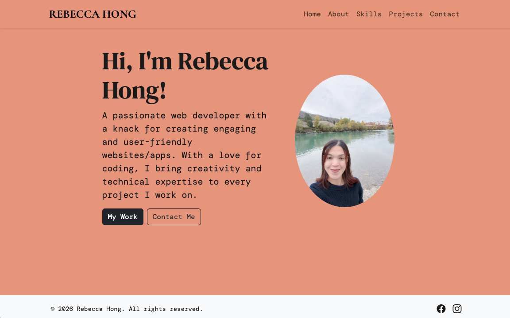

# Rebecca Hong — Developer Portfolio

My personal portfolio website, built to introduce my background, showcase my software projects and share my technical skills.

**[View live portfolio](https://rebecca-hong.vercel.app/)**


## Overview

This project began as a Web Applications assignment at the Southern Institute of Technology (SIT). I now maintain it as my personal developer portfolio.

The website brings together information about me, my projects and my skills in one place, giving potential employers an introduction to my work.

## Pages

- **Home** — An introduction to me and my portfolio.
- **About** — My background and development journey.
- **Projects** — A selection of my software projects.
- **Skills** — My technical skills and tools.
- **Contact** — Ways to get in touch.

## Technologies

- **React and JavaScript** — User interface and component logic.
- **React Router** — Navigation between pages.
- **Bootstrap and Bootstrap Icons** — Styling and icons.
- **Vite** — Development server and production builds.
- **Vercel** — Website hosting.

## Run Locally

Install Node.js and npm, then run:

```bash
git clone https://github.com/beca88/rebecca-hong-portfolio.git
cd rebecca-hong-portfolio/rebecca-portfolio
npm ci
npm run dev
```

Open the local URL displayed in your terminal.

### Other Commands

Run these from the `rebecca-portfolio` application folder:

```bash
npm run build
npm run preview
npm run lint
```

- `build` creates a production build.
- `preview` serves the production build locally.
- `lint` checks the code using ESLint.

## Project Structure

The React application is located inside the `rebecca-portfolio` folder.

- `src/components/` — Shared interface components, including navigation and footer.
- `src/pages/` — Individual website pages.
- `public/` — Static assets.
- `package.json` — Application dependencies and scripts.

## Development Focus

The project brings together component-based development, page routing and interface styling. Shared components such as the navigation bar and footer help keep the website consistent across pages.

I continue to update the content as my skills and project experience grow.

## Planned Improvements

- Add detailed project case studies describing the problem, my contribution and technical decisions.
- Review accessibility, including keyboard navigation and colour contrast.
- Refine the layout across different screen sizes.
- Add automated checks for important user interactions.

## Author

**Rebecca Hong**

- [GitHub](https://github.com/beca88)
- [Portfolio](https://rebecca-hong.vercel.app/)
